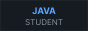
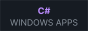
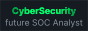

  

<h1 align="center">hi, i'm qqkillua ～☆</h1>

  

  Nikita Bainov · software developer student · on my way to cybersecurity

  
  
  

<h3 align="center">about me :3</h3>

  🎓 studying software development at college 
  ☕ writing Java for classes and C# for my own Windows tools 
  🛡️ getting into cybersecurity — aiming to become a SOC analyst

<h3 align="center">projects</h3>

<table align="center">
  <tr>
    <td align="center" width="96">
      
    </td>
    <td>
      <a href="https://github.com/qqkillua/VolumeGuard"><b>VolumeGuard</b></a> 
      per-app volume limiter for Windows — no more ear-blasting ads and explosions 
      C# · WinForms · Windows Core Audio
    </td>
  </tr>
</table>

  thanks for stopping by ✦

